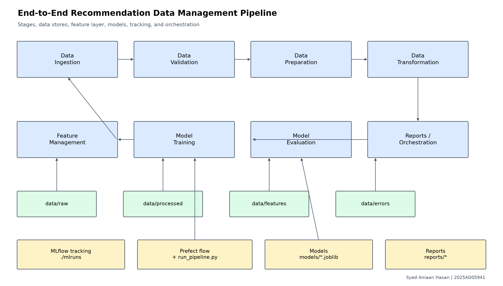
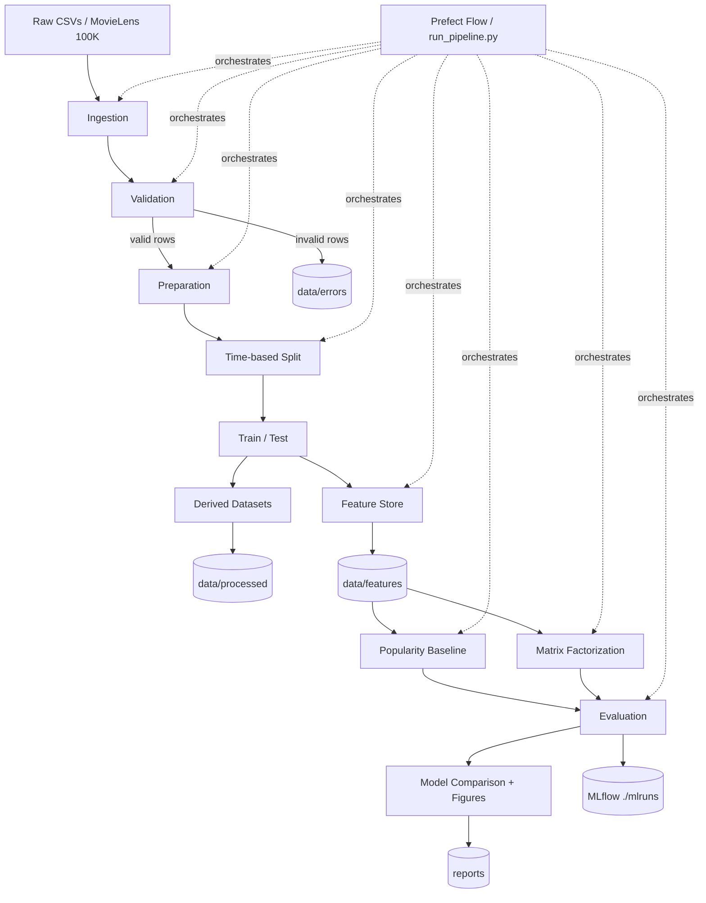
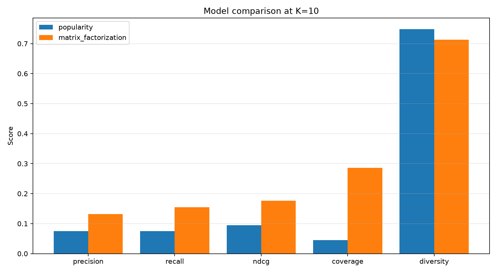
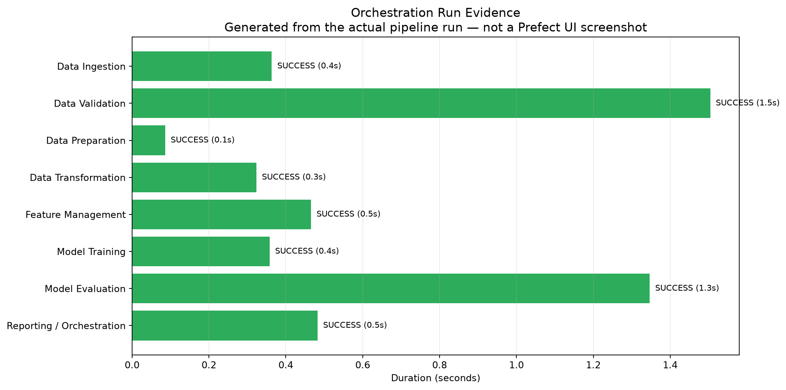

# End-to-End Data Management Pipeline for a Recommendation System

**Student:** Syed Amaan Hasan  
**ID:** 2025AG05941  
**Course:** Data Management for Machine Learning (DM4ML), Assignment 2  
**Repository:** [hasansyedamaan/dmml_assignment2](https://github.com/hasansyedamaan/dmml_assignment2)  
**Branch:** `main`  
**Report date:** 10 November 2026

> Individual assignment. All code, experiments, tables, figures, and results in this report were produced from the repository in this submission. This Markdown file is the full submission report; the required 2-3 page PDF version is also included as [`final_report.pdf`](final_report.pdf). The checked-in run is recorded in [`run_log.txt`](run_log.txt).

---

## Table of contents

1. [Abstract](#1-abstract)
2. [Introduction and problem statement](#2-introduction-and-problem-statement)
3. [Repository, setup, and submission artifacts](#3-repository-setup-and-submission-artifacts)
4. [Architecture and design decisions](#4-architecture-and-design-decisions)
5. [Dataset](#5-dataset)
6. [Data validation and quarantine](#6-data-validation-and-quarantine)
7. [Preparation, transformation, and time-based split](#7-preparation-transformation-and-time-based-split)
8. [Feature management](#8-feature-management)
9. [Model training](#9-model-training)
10. [Evaluation and results](#10-evaluation-and-results)
11. [Orchestration](#11-orchestration)
12. [MLflow experiment tracking](#12-mlflow-experiment-tracking)
13. [Reproducibility and testing](#13-reproducibility-and-testing)
14. [Limitations and future work](#14-limitations-and-future-work)
15. [Conclusion](#15-conclusion)
16. [References](#16-references)
- [Appendix A: Configuration](#appendix-a-configuration)
- [Appendix B: Full feature catalog](#appendix-b-full-feature-catalog)
- [Appendix C: Submission evidence checklist](#appendix-c-submission-evidence-checklist)

---

## 1. Abstract

This project implements a reproducible, end-to-end data-management pipeline for a movie recommendation system using MovieLens 100K. The pipeline ingests raw users, items, and timestamped ratings; validates and quarantines malformed records; prepares clean tables; performs a leakage-safe time-based train/test split; builds a train-only feature layer with an explicit as-of date; trains a popularity baseline and a matrix-factorization recommender; evaluates ranking, coverage, diversity, and rating-prediction metrics; tracks both models in MLflow; and produces reports, figures, and orchestration evidence.

The checked-in run used MovieLens 100K and enabled fault injection to demonstrate validation. All 14 injected or malformed records were detected and quarantined, leaving 99,991 clean interactions. The temporal split produced 79,614 training interactions and 20,377 test interactions, with zero cold-start test users and 71 cold-start test items. The personalized model improved every ranking metric over the popularity baseline: Precision@10 rose from 0.0754 to 0.1320, Recall@10 from 0.0749 to 0.1543, NDCG@10 from 0.0943 to 0.1763, and catalog coverage from 0.0447 to 0.2862. Rating error also improved, with RMSE falling from 1.0735 to 1.0082 and MAE from 0.8587 to 0.7915.

**Keywords:** data management, recommendation systems, MovieLens, validation, quarantine, time-based split, feature store, matrix factorization, MLflow, Prefect.

---

## 2. Introduction and problem statement

Online platforms need recommendation pipelines that are not only accurate but also auditable and reproducible. Raw interaction data commonly contains missing values, duplicates, malformed types, invalid ratings, impossible timestamps, and orphan references. A recommendation model trained on such data can silently learn from corrupt records or leak future information into the training set. The assignment therefore focuses on the complete data-management path rather than on maximizing a single accuracy score.

The project addresses four practical problems:

1. **Data quality:** invalid records must be detected, explained, and separated instead of silently dropped.
2. **Temporal correctness:** the test set must represent future behaviour, not a random sample of the same time period.
3. **Feature leakage:** features used for training and prediction must be computed from training data only, with an explicit reference date.
4. **Operational reproducibility:** the same pipeline must run from a plain CLI and from a Prefect flow, with configuration-driven paths, seeds, and model parameters, and with tracked experiments.

The result is a modular Python pipeline that writes Parquet/CSV evidence at each stage and produces a complete submission package: source code, tests, configuration, processed data, features, error datasets, serialized models, validation reports, a feature catalog, model-comparison tables and figures, a run log, an architecture diagram, and a 3-page PDF report.

---

## 3. Repository, setup, and submission artifacts

### 3.1 Repository

```text
https://github.com/hasansyedamaan/dmml_assignment2
```

Clone and run from the repository root:

```powershell
git clone https://github.com/hasansyedamaan/dmml_assignment2.git
cd dmml_assignment2

python -m venv .venv
.venv\Scripts\Activate.ps1
python -m pip install -r requirements.txt
```

### 3.2 Main commands

```powershell
# Full pipeline; downloads MovieLens 100K if data/raw/ml-100k is absent
python run_pipeline.py

# Validation demonstration: inject known faults into a copy of the raw data
python run_pipeline.py --inject-faults

# Reuse the existing local MovieLens directory
python run_pipeline.py --skip-download

# Prefect flow entrypoint (same stage functions, retryable tasks)
python dags/recommendation_flow.py
python dags/recommendation_flow.py --inject-faults

# Tests
python -m pytest
python -m pytest tests/test_metrics.py -k test_name

# Inspect the two MLflow runs
mlflow ui --backend-store-uri ./mlruns
```

### 3.3 Environment

| Component | Version / note |
|---|---|
| Python | 3.15.0 |
| pandas | 3.1.1 |
| NumPy | 2.5.4 |
| SciPy | 1.18.1 |
| PyArrow | 26.0.1 |
| scikit-learn | 1.9.1 |
| matplotlib | 3.11.2 |
| ReportLab | 5.1.0 |
| Pandera | 0.35.0 |
| MLflow | 3.18.0 |
| Prefect | 3.9.2 |
| pytest | 9.2.0 |
| pypdf | 7.0.0 |
| PyYAML | 6.0.3, vendored as a pure-Python wheel |

`implicit` and `surprise` were not installed because compatible wheels were unavailable in this environment. The assignment permits a scikit-learn/SciPy fallback, which is implemented with `TruncatedSVD`. PyYAML 6.0.3 has no CPython 3.15 wheel and the machine lacks MSVC build tools, so the pure-Python wheel is stored at `vendor/pyyaml-6.0.3-py3-none-any.whl` and referenced directly by `requirements.txt`.

### 3.4 Repository layout

```text
.
├── configs/
│   └── config.yaml                 # paths, K, split rule, seeds, model params
├── dags/
│   └── recommendation_flow.py      # Prefect flow with retryable stage tasks
├── data/
│   ├── raw/                        # unchanged raw copies + ingestion metadata
│   ├── processed/                  # cleaned tables, train/test, derived datasets
│   ├── features/                   # user/item/interaction feature Parquet files
│   └── errors/                     # quarantined rows with failed_rules
├── models/                         # serialized recommenders + metadata
├── reports/                        # reports, figures, PDF, run log, stage status
├── src/
│   ├── ingestion/
│   ├── validation/
│   ├── preparation/
│   ├── transformation/
│   ├── features/
│   ├── training/
│   ├── evaluation/
│   ├── reporting/
│   └── utils/
├── tests/
├── vendor/
│   └── pyyaml-6.0.3-py3-none-any.whl
├── requirements.txt
├── run_pipeline.py
└── README.md
```

### 3.5 Submission artifact map

| Required evidence | Location |
|---|---|
| Source code | `src/`, `run_pipeline.py`, `dags/` |
| Configuration | `configs/config.yaml` |
| Dependency pins | `requirements.txt` |
| README | [`README.md`](../README.md) |
| Validation report | [`validation_report.md`](validation_report.md), [`.csv`](validation_report.csv), [`.json`](validation_report.json) |
| Quarantined records | `data/errors/` |
| Feature catalog | [`feature_catalog.md`](feature_catalog.md), [`.csv`](feature_catalog.csv) |
| Model comparison | [`model_comparison.md`](model_comparison.md), [`.csv`](model_comparison.csv) |
| Figures | [`reports/figures/`](figures/) |
| Run log | [`run_log.txt`](run_log.txt) |
| Final report (Markdown) | [`final_report.md`](final_report.md) |
| Final PDF | [`final_report.pdf`](final_report.pdf) |
| Architecture | [`architecture.mmd`](architecture.mmd), [`figures/architecture.png`](figures/architecture.png) |
| Serialized models | `models/popularity.joblib`, `models/matrix_factorization.joblib` |
| Tests | [`tests/`](../tests/) |
| MLflow store | `mlruns/` (local file store) |

### 3.6 Tools used and rationale

| Tool | Role in the project | Why it was chosen |
|---|---|---|
| Python 3.15 | Implementation language | Typed, modular code with a mature data/ML ecosystem |
| pandas, NumPy, SciPy | Tabular processing and sparse matrix operations | Direct support for grouped temporal logic, sparse ratings, and SVD |
| PyArrow + Parquet | Processed and feature storage | Typed, columnar, compact, and portable evidence files |
| Pandera | Schema validation gate | Declarative dtype/range schema on top of row-level rule checks |
| scikit-learn `TruncatedSVD` | Matrix-factorization ranking and rating model | Compatible wheel, deterministic seed, no compiler dependency |
| joblib | Model serialization | Standard persistence for scikit-learn-style estimators |
| MLflow | Experiment tracking | Local file store with parameters, metrics, artifacts, and a UI |
| Prefect | Orchestration | Python-native retries, explicit stage dependencies, local execution |
| matplotlib | Report figures | Reproducible static figures generated from real run artifacts |
| ReportLab, pypdf | PDF generation and verification | 3-page PDF report plus programmatic page-count check |
| pytest | Unit testing | Small, readable tests for validation, splits, metrics, and models |
| PyYAML | Configuration parsing | One external config for paths, seeds, split, and model settings |

---

## 4. Architecture and design decisions



*Figure 1: Pipeline architecture, data stores, feature layer, models, tracking, and orchestration. Source: [`architecture.mmd`](architecture.mmd).*

The Mermaid source of the same architecture is:



The design is intentionally linear and idempotent:

- **Ingestion** writes unchanged raw copies and metadata before any transformation.
- **Validation** produces a clean path and a separate quarantine path; invalid rows never reach the clean tables.
- **Preparation** applies documented fallbacks to surviving rows and standardizes types and timestamps.
- **Transformation** performs a time-based split and writes train/test plus derived datasets.
- **Feature management** builds train-only features with an explicit as-of date and exposes the same serving methods for training and prediction.
- **Training** fits two models with a common interface and serializes them.
- **Evaluation** computes ranking, coverage, diversity, and rating metrics and writes comparison tables and a chart.
- **Reporting, MLflow, and orchestration** record the actual run and produce the submission evidence.

All paths, thresholds, seeds, and model parameters are read from `configs/config.yaml`. The shared stage functions in `src/pipeline.py` are used by both the plain CLI and the Prefect flow, so the two entrypoints cannot drift apart.

The stage order is:

```python
state["raw"] = run_stage(config, "ingest", stage_ingest, config, inject_faults_flag, skip_download)
state["validated"] = run_stage(config, "validate", stage_validate, config, state["raw"])
state["prepared"] = run_stage(config, "prepare", stage_prepare, config, state["validated"])
state["transformed"] = run_stage(config, "transform", stage_transform, config, state["prepared"])
state["features"] = run_stage(config, "features", stage_features, config, state["transformed"])
state["trained"] = run_stage(config, "train", stage_train, config, state["transformed"])
state["evaluation"] = run_stage(config, "evaluate", stage_evaluate, config, state["transformed"], state["trained"])
state["report"] = run_stage(config, "report", stage_report, config, state)
```

---

## 5. Dataset

### 5.1 Source

The primary dataset is **MovieLens 100K**, downloaded from:

```text
https://files.grouplens.org/datasets/movielens/ml-100k.zip
```

It is extracted into `data/raw/ml-100k/`. The source and row counts are recorded in `data/raw/ingestion_metadata.json` and `reports/run_summary.json`.

| Table | Rows in the clean MovieLens source | Key columns |
|---|---:|---|
| Users | 943 | `user_id`, `age`, `gender`, `occupation`, `zip` |
| Items | 1,682 | `item_id`, `title`, `release_date`, `genres`, `primary_genre` |
| Interactions | 100,000 | `user_id`, `item_id`, `rating` (1-5), `timestamp` |

The validated run in this report used the **MovieLens 100K** source, not synthetic data. If MovieLens cannot be downloaded or loaded, `src/ingestion/synthetic.py` provides a deterministic synthetic fallback with users, items, genres, timestamps, and a long-tail popularity distribution. The fallback source is recorded in the same metadata files.

### 5.2 Fault-injection run

The checked-in validation evidence is from the demonstration run:

```powershell
python run_pipeline.py --inject-faults --skip-download
```

Fault injection adds known bad records to a copy of the raw data. The demonstration run therefore starts with:

| Table | Rows before validation |
|---|---:|
| Users | 945 |
| Items | 1,684 |
| Interactions | 100,001 |

After validation and quarantine, 943 users, 1,682 items, and 99,991 interactions continue through the clean path. Model metrics in this report are computed from that cleaned data.

### 5.3 Raw data preservation

The ingestion stage writes the unchanged raw columns to:

- `data/raw/users.csv`
- `data/raw/items.csv`
- `data/raw/interactions.csv`
- `data/raw/users_faulty.csv`, `items_faulty.csv`, `interactions_faulty.csv` for the demo run

The raw copies preserve the source values; cleaning happens only after validation. This makes the quarantine evidence auditable.

---

## 6. Data validation and quarantine

### 6.1 Validation design

Validation is implemented in `src/validation/validators.py`. It uses two complementary layers:

1. **Row-level rule checks** that record every failed rule for each row and route invalid rows to `data/errors/`.
2. **Pandera schema checks** on the surviving clean rows, reported as an additional schema gate.

The row-level rules cover:

- missing required values;
- duplicate records;
- incorrect data types;
- ratings outside the configured `[1, 5]` range;
- unparseable, future, or too-old timestamps;
- invalid IDs;
- orphan `user_id` and `item_id` references;
- invalid ages, genders, and item release dates.

The validation output includes `failed_rules` and `dataset` columns, so a single row can show multiple failures.

### 6.2 Core validation pattern

```python
rules = [
    "missing_required_value",
    "duplicate_record",
    "incorrect_dtype",
    "invalid_rating",
    "invalid_timestamp",
    "invalid_id",
    "orphan_user_id",
    "orphan_item_id",
]
failed = _new_failures(interactions, rules)
_missing_checks(interactions, INTERACTION_REQUIRED, failed)
_duplicate_checks(interactions, config["validation"]["duplicate_key"]["interactions"], failed)
working = _numeric_working_frame(interactions, INTERACTION_NUMERIC, failed)

_mark(failed, "invalid_rating",
      working["rating"].notna()
      & ((working["rating"] < rating_min) | (working["rating"] > rating_max)))

parsed_ts = pd.to_datetime(working["timestamp"], unit="s", errors="coerce", utc=True)
_mark(failed, "invalid_timestamp", interactions["timestamp"].notna() & parsed_ts.isna())
_mark(failed, "invalid_timestamp",
      parsed_ts.notna() & ((parsed_ts < minimum) | (parsed_ts > maximum)))
```

Rows with no failed rule form the clean table. Rows with at least one failed rule are written to both Parquet and CSV, with a semicolon-separated `failed_rules` value.

### 6.3 Fault injection

`src/ingestion/ingest.py` injects deterministic faults covering every required class:

```python
# Missing values on extra rows that no interaction references
missing_user = {column: users_faulty.iloc[0][column] for column in USER_COLUMNS}
missing_user.update({"user_id": 999998, "gender": np.nan})
users_faulty = pd.concat([users_faulty, pd.DataFrame([missing_user])], ignore_index=True)

missing_item = {column: items_faulty.iloc[0][column] for column in items_faulty.columns}
missing_item.update({"item_id": 999998, "title": np.nan})
items_faulty = pd.concat([items_faulty, pd.DataFrame([missing_item])], ignore_index=True)

# Duplicate rows
users_faulty = pd.concat([users_faulty, users_faulty.iloc[[1]]], ignore_index=True)
items_faulty = pd.concat([items_faulty, items_faulty.iloc[[1]]], ignore_index=True)
interactions_faulty = pd.concat(
    [interactions_faulty, interactions_faulty.iloc[[1]]], ignore_index=True
)

# Missing rating, invalid ratings, future timestamp, too-old timestamp
interactions_faulty.loc[10, "rating"] = np.nan
interactions_faulty.loc[12, "rating"] = 9
interactions_faulty.loc[13, "rating"] = -1
interactions_faulty.loc[14, "timestamp"] = 2524608000   # 2050-01-01 UTC
interactions_faulty.loc[18, "timestamp"] = 0

# Wrong dtype and unparseable timestamp
interactions_faulty["user_id"] = interactions_faulty["user_id"].astype(object)
interactions_faulty.loc[15, "user_id"] = "not-an-integer"
interactions_faulty["timestamp"] = interactions_faulty["timestamp"].astype(object)
interactions_faulty.loc[19, "timestamp"] = "not-a-timestamp"

# Referential integrity failures
interactions_faulty.loc[16, "user_id"] = 999999
interactions_faulty.loc[17, "item_id"] = 999999
```

### 6.4 Validation results

| Dataset | Rows in | Rows valid | Rows rejected | Pandera schema |
|---|---:|---:|---:|---|
| Users | 945 | 943 | 2 | PASS |
| Items | 1,684 | 1,682 | 2 | PASS |
| Interactions | 100,001 | 99,991 | 10 | PASS |

Full per-check counts:

| Dataset | Check | Rows flagged | Status |
|---|---|---:|---|
| users | missing_required_value | 1 | FAIL |
| users | duplicate_record | 1 | FAIL |
| users | incorrect_dtype | 0 | PASS |
| users | invalid_age | 0 | PASS |
| users | invalid_gender | 0 | PASS |
| users | invalid_id | 0 | PASS |
| users | pandera_schema | 0 | PASS |
| items | missing_required_value | 1 | FAIL |
| items | duplicate_record | 1 | FAIL |
| items | incorrect_dtype | 0 | PASS |
| items | invalid_date | 0 | PASS |
| items | invalid_id | 0 | PASS |
| items | pandera_schema | 0 | PASS |
| interactions | missing_required_value | 1 | FAIL |
| interactions | duplicate_record | 1 | FAIL |
| interactions | incorrect_dtype | 2 | FAIL |
| interactions | invalid_rating | 2 | FAIL |
| interactions | invalid_timestamp | 3 | FAIL |
| interactions | invalid_id | 0 | PASS |
| interactions | orphan_user_id | 1 | FAIL |
| interactions | orphan_item_id | 1 | FAIL |
| interactions | pandera_schema | 0 | PASS |

### 6.5 Quarantine evidence

The rejected rows are stored in `data/errors/`. Example interaction failures:

| user_id | item_id | rating | timestamp | failed_rules | dataset |
|---|---:|---:|---:|---|---|
| 62 | 257 | — | 879372434 | missing_required_value | interactions |
| 200 | 222 | 9.0 | 876042340 | invalid_rating | interactions |
| 210 | 40 | -1.0 | 891035994 | invalid_rating | interactions |
| 224 | 29 | 3.0 | 2524608000 | invalid_timestamp | interactions |
| not-an-integer | 785 | 3.0 | 879485318 | incorrect_dtype | interactions |
| 999999 | 387 | 5.0 | 879270459 | orphan_user_id | interactions |
| 194 | 999999 | 2.0 | 879539794 | orphan_item_id | interactions |
| 291 | 1042 | 4.0 | 0 | invalid_timestamp | interactions |
| 234 | 1184 | 2.0 | not-a-timestamp | incorrect_dtype;invalid_timestamp | interactions |
| 186 | 302 | 3.0 | 891717742 | duplicate_record | interactions |

The user and item error files contain the corresponding missing-value and duplicate records. The full evidence is in:

- `data/errors/users_errors.csv` / `.parquet`
- `data/errors/items_errors.csv` / `.parquet`
- `data/errors/interactions_errors.csv` / `.parquet`

---

## 7. Preparation, transformation, and time-based split

### 7.1 Preparation

`src/preparation/prepare.py` applies documented fallbacks only to rows that survive validation:

- Rows with missing IDs, ratings, or timestamps are dropped.
- Missing user age is filled with the median age.
- Missing gender becomes `U`; missing occupation or ZIP becomes `unknown`.
- Missing item titles become `Untitled`.
- Duplicate IDs and duplicate interactions keep the first occurrence.
- Interaction timestamps are converted to UTC `datetime64`.
- Genres are standardized into a list and a `primary_genre`.

After preparation, the tables are written to `data/processed/users.parquet`, `items.parquet`, and `interactions.parquet`.

### 7.2 Time-based split

The split is **time-based, never random**. The default method is `per_user_last_fraction`: each user's interactions are ordered by timestamp and the final 20% become test data. This is implemented in `src/transformation/split.py`.

```python
ordered = interactions.sort_values(["user_id", "timestamp", "item_id"]).reset_index(drop=True)

for user_id, group in ordered.groupby("user_id", sort=True):
    count = len(group)
    if count < 2:
        train_parts.append(group)
        continue
    requested = max(int(min_test_interactions), int(math.ceil(count * fraction)))
    test_count = min(max(1, requested), count - 1)
    train_count = count - test_count
    train_parts.append(group.iloc[:train_count])
    test_parts.append(group.iloc[train_count:])
```

Why this choice:

- A global cutoff on MovieLens 100K would create many cold-start users.
- Per-user split keeps every test user warm and guarantees that no test interaction precedes that user's training cutoff.
- The cost is cold-start items: 71 test items are unseen in training. They are not recommendable and therefore count as misses.

The alternative `global_time_quantile` mode is available in `configs/config.yaml` for comparison.

### 7.3 Split results

| Metric | Value |
|---|---:|
| Method | `per_user_last_fraction` |
| Test fraction | 0.2 |
| Minimum test interactions per user | 1 |
| Train interactions | 79,614 |
| Test interactions | 20,377 |
| Train users | 943 |
| Test users | 943 |
| Train items | 1,611 |
| Test items | 1,508 |
| Cold-start test users | 0 |
| Cold-start test items | 71 |
| Cold-start test item rows | 88 |
| No test before cutoff | `true` |
| Cutoff minimum | `1997-09-20 20:17:44+00:00` |
| Cutoff median | `1998-01-02 03:45:16+00:00` |
| Cutoff maximum | `1998-04-22 23:10:38+00:00` |

### 7.4 Derived datasets

The transformation stage writes the following train-only datasets to `data/processed/`:

| Dataset | Rows / shape | File |
|---|---:|---|
| User activity summary | 943 rows | `user_activity_summary.parquet` |
| Item popularity | 1,611 rows | `item_popularity.parquet` |
| User-item rating matrix | 943 x 1,611, 79,614 non-zeros | `user_item_matrix.npz` |
| User index | 943 rows | `user_index.csv` |
| Item index | 1,611 rows | `item_index.csv` |
| Train interactions | 79,614 rows | `train.parquet` |
| Test interactions | 20,377 rows | `test.parquet` |
| Split metadata | — | `split_metadata.json`, `split_cutoffs.csv` |

The user activity summary includes interaction count, average rating, rating standard deviation, distinct items, first interaction time, last interaction time, and preferred category. Item popularity includes interaction count, average rating, rating count, distinct users, title, primary genre, release date, and popularity rank.

---

## 8. Feature management

### 8.1 Design

`src/features/feature_store.py` implements a reusable `FeatureStore`:

- `build_features(train, users, items)` computes user, item, and interaction features from the **training split only**.
- `get_user_features(user_ids)` and `get_item_features(item_ids)` serve stored features with documented defaults for unseen entities.
- `get_interaction_features(user_ids, item_ids, timestamps, ratings)` builds interaction rows through the same serving path used at prediction time.

The as-of date defaults to the maximum training timestamp. In the checked-in run it is:

```text
1998-04-22 23:10:38+00:00
```

The feature metadata records the as-of source, training row count, feature row counts, default values, and the leakage guard:

```json
{
  "as_of_date": "1998-04-22 23:10:38+00:00",
  "as_of_source": "train_max",
  "train_rows": 79614,
  "user_feature_rows": 943,
  "item_feature_rows": 1682,
  "interaction_feature_rows": 79614,
  "leakage_guard": "All features are computed from the train split only."
}
```

### 8.2 Feature construction excerpt

```python
as_of = self._resolve_as_of(train)

users = (
    train.groupby("user_id")
    .agg(
        avg_rating=("rating", "mean"),
        activity_count=("item_id", "size"),
        rating_std=("rating", "std"),
        distinct_items_count=("item_id", "nunique"),
        last_interaction_time=("timestamp", "max"),
    )
    .reset_index()
)
users["rating_std"] = users["rating_std"].fillna(0.0)
users["days_since_last_interaction"] = (
    (as_of - users["last_interaction_time"]).dt.total_seconds() / 86400.0
).clip(lower=0.0)
```

The item side computes popularity, average rating, rating count, category, item age, and one-hot genre indicators. Interaction features add hour of day, day of week, user-item genre match, and recency rank.

### 8.3 Feature catalog

The catalog is generated programmatically from `src/features/registry.py` into `reports/feature_catalog.md` and `reports/feature_catalog.csv`. It is not hand-written. The full table is reproduced in [Appendix B](#appendix-b-full-feature-catalog).

Summary of the feature groups:

| Entity | Features |
|---|---|
| User | `avg_rating`, `activity_count`, `preferred_category`, `days_since_last_interaction`, `rating_std`, `distinct_items_count` |
| Item | `popularity`, `avg_rating`, `rating_count`, `category`, `genre_*`, `item_age_years` |
| Interaction | `rating`, `timestamp`, `hour`, `day_of_week`, `user_item_genre_match`, `recency_rank` |

The feature layer is batch-oriented and is exercised by the pipeline and tests. The current recommenders consume the cleaned interaction matrix directly; the feature store provides a reusable feature contract and documented cold-start defaults for future feature-aware models. This limitation is discussed in [Section 14](#14-limitations-and-future-work).

---

## 9. Model training

### 9.1 Common interface

Both recommenders inherit from `BaseRecommender` in `src/training/base.py`:

```python
class BaseRecommender(ABC):
    @abstractmethod
    def fit(self, train: pd.DataFrame) -> "BaseRecommender":
        """Fit the model on a training interaction table."""

    @abstractmethod
    def recommend(self, user_id: int, k: int = 10, exclude_seen: bool = True) -> List[int]:
        """Return the top-k item ids for one user."""

    def recommend_batch(self, user_ids, k=10, exclude_seen=True):
        return {
            int(user_id): self.recommend(int(user_id), k=k, exclude_seen=exclude_seen)
            for user_id in user_ids
        }

    def predict(self, user_id: int, item_id: int) -> float:
        """Predict an explicit rating when the model supports it."""
        raise NotImplementedError(f"{self.name} does not predict explicit ratings.")
```

Both models expose `fit`, `recommend`, `recommend_batch`, and `predict`.

### 9.2 Popularity baseline

`PopularityRecommender` ranks unseen items by training interaction count with stable item-id tie-breaking. For rating prediction it returns the item's training mean rating, falling back to the global mean for unseen items.

```python
counts = train.groupby("item_id").size().sort_values(ascending=False)
counts = counts.sort_index().sort_values(ascending=False, kind="stable")
self.item_popularity = counts
self.item_means = train.groupby("item_id")["rating"].mean()
self.global_mean = float(train["rating"].mean())
```

### 9.3 Matrix-factorization recommender

`MatrixFactorizationRecommender` uses scikit-learn `TruncatedSVD` on the sparse user-item rating matrix for ranking. A separate bias-aware residual SVD handles explicit rating prediction:

$$
\hat{r}_{ui} = \mu + b_u + b_i + p_u^\top q_i
$$

where $\mu$ is the global mean, $b_u$ and $b_i$ are user/item offsets, and the final term is the low-rank residual score. Predictions are clipped to the configured `[1, 5]` range.

Hyperparameters from `configs/config.yaml`:

| Parameter | Value |
|---|---:|
| `n_components` | 32 |
| `n_iter` | 12 |
| `random_state` | 42 |
| `clip_min` | 1.0 |
| `clip_max` | 5.0 |
| Explained variance (ranking SVD) | 0.4497 |

Cold-start handling: if a user is unseen, the model falls back to popularity-ranked items; if an item is unseen during rating prediction, it falls back to the item mean or the global mean.

### 9.4 Persisted models

Both fitted models are serialized with `joblib`:

- `models/popularity.joblib`
- `models/matrix_factorization.joblib`
- `models/model_metadata.json`

Model metadata records the training row count, catalog size, model parameters, and the matrix-factorization explained variance.

---

## 10. Evaluation and results

### 10.1 Relevance definition

A test item is relevant when its observed test rating is **at least 4**:

```yaml
evaluation:
  relevance_threshold: 4
```

Ranking metrics are averaged over test users with at least one relevant item. In the checked-in run, 943 users were evaluated and 908 had at least one relevant test item.

### 10.2 Metric definitions

For a user $u$, let $R(u)$ be the top-$K$ recommendation list and $Rel(u)$ the set of relevant test items.

**Precision@K**

$$
Precision@K(u) = \frac{|R(u) \cap Rel(u)|}{K}
$$

**Recall@K**

$$
Recall@K(u) = \frac{|R(u) \cap Rel(u)|}{|Rel(u)|}
$$

**NDCG@K** uses binary relevance and discounted gain:

$$
DCG@K = \sum_{i=1}^{K} \frac{rel_i}{\log_2(i+1)}, \qquad
NDCG@K = \frac{DCG@K}{IDCG@K}
$$

**Catalog coverage**

$$
Coverage = \frac{|\bigcup_u R(u)|}{|I_{train}|}
$$

Coverage is the number of unique recommended items divided by the training catalog size (1,611 items).

**Intra-list diversity**

Diversity is the mean pairwise cosine distance between item genre vectors in each recommendation list, averaged over users with at least two known item vectors:

$$
Diversity = \frac{1}{N}\sum_u \frac{2}{|R(u)|(|R(u)|-1)}
\sum_{i<j} \left(1 - \cos(v_i, v_j)\right)
$$

**Rating metrics**

$$
RMSE = \sqrt{\frac{1}{N}\sum_{i=1}^{N}(\hat{r}_i - r_i)^2},
\qquad
MAE = \frac{1}{N}\sum_{i=1}^{N}|\hat{r}_i - r_i|
$$

### 10.3 Results at K = 10

| Model | Precision@10 | Recall@10 | NDCG@10 | Coverage@10 | Diversity@10 | RMSE | MAE |
|---|---:|---:|---:|---:|---:|---:|---:|
| Popularity | 0.0754 | 0.0749 | 0.0943 | 0.0447 | 0.7478 | 1.0735 | 0.8587 |
| Matrix factorization | **0.1320** | **0.1543** | **0.1763** | **0.2862** | 0.7128 | **1.0082** | **0.7915** |

### 10.4 Results at K = 5

| Model | Precision@5 | Recall@5 | NDCG@5 | Coverage@5 | Diversity@5 |
|---|---:|---:|---:|---:|---:|
| Popularity | 0.0769 | 0.0402 | 0.0880 | 0.0273 | 0.7812 |
| Matrix factorization | **0.1566** | **0.0941** | **0.1746** | **0.2228** | 0.6970 |



*Figure 2: Model comparison at K=10. The personalized model improves ranking quality and catalog coverage while remaining slightly less diverse.*

### 10.5 Discussion

The personalized model improves every ranking metric over the popularity baseline:

| Metric | Popularity | Matrix factorization | Relative change |
|---|---:|---:|---:|
| Precision@10 | 0.0754 | 0.1320 | +75.0% |
| Recall@10 | 0.0749 | 0.1543 | +106.1% |
| NDCG@10 | 0.0943 | 0.1763 | +87.0% |
| Coverage@10 | 0.0447 | 0.2862 | +540.2% |
| Diversity@10 | 0.7478 | 0.7128 | -4.7% |
| RMSE | 1.0735 | 1.0082 | -6.1% |
| MAE | 0.8587 | 0.7915 | -7.8% |

The largest practical improvement is catalog coverage: the popularity baseline recommends a very narrow set of globally popular items, while the latent-factor model produces more user-specific lists and covers 28.6% of the training catalog. The slight drop in diversity is expected because personalized lists concentrate on genres and items preferred by each user. The rating-error improvement shows that the bias-aware residual SVD is also a better explicit-rating estimator than the item-mean baseline.

The results should be interpreted as a data-management and reproducibility outcome, not a leaderboard result. MovieLens 100K is small, and no extensive hyperparameter search was performed.

---

## 11. Orchestration

### 11.1 Two entrypoints, one set of stages

- `run_pipeline.py` is the plain-Python CLI. It runs the stage functions sequentially and is useful without a Prefect server.
- `dags/recommendation_flow.py` is the Prefect flow. It wraps the same stage functions in tasks with two retries and explicit dependencies.

```python
@task(retries=2, retry_delay_seconds=3)
def ingest_task(config, inject_faults_flag, skip_download):
    return run_stage(config, "ingest", stage_ingest, config, inject_faults_flag, skip_download)

@task(retries=2, retry_delay_seconds=3)
def validate_task(config, raw):
    return run_stage(config, "validate", stage_validate, config, raw)

# ...

state = {}
state["raw"] = ingest_task(config, inject_faults, skip_download)
state["validated"] = validate_task(config, state["raw"])
state["prepared"] = prepare_task(config, state["validated"])
state["transformed"] = transform_task(config, state["prepared"])
state["features"] = features_task(config, state["transformed"])
state["trained"] = train_task(config, state["transformed"])
state["evaluation"] = evaluate_task(config, state["transformed"], state["trained"])
state["report"] = report_task(config, state)
state["summary"] = finalize_run(config, state)
```

### 11.2 Actual stage timings

| Stage | Status | Duration (s) |
|---|---|---:|
| ingest | SUCCESS | 0.36 |
| validate | SUCCESS | 1.50 |
| prepare | SUCCESS | 0.09 |
| transform | SUCCESS | 0.32 |
| features | SUCCESS | 0.47 |
| train | SUCCESS | 0.36 |
| evaluate | SUCCESS | 1.35 |
| report | SUCCESS | 0.48 |

The full console and file log is in [`run_log.txt`](run_log.txt). Key lines from the actual run:

```text
2026-11-10 04:50:06 | INFO | src.pipeline | Starting stage: ingest
2026-11-10 04:50:06 | INFO | src.ingestion.ingest | Ingested movielens100k data: users=945 items=1684 interactions=100001
2026-11-10 04:50:08 | INFO | src.validation.validators | Validated interactions: in=100001 valid=99991 rejected=10 pandera=True
2026-11-10 04:50:08 | INFO | src.transformation.split | Time split (per_user_last_fraction): train=79614 test=20377; cold-start test users=0 items=71; no test before per-user cutoff=True
2026-11-10 04:50:10 | INFO | src.evaluation.evaluate | Evaluated matrix_factorization: precision@10=0.1320 recall@10=0.1543 ndcg@10=0.1763 coverage=0.2862 diversity=0.7128
2026-11-10 04:50:12 | INFO | src.training.tracking | Logged MLflow run for popularity
2026-11-10 04:50:12 | INFO | src.training.tracking | Logged MLflow run for matrix_factorization
2026-11-10 04:50:13 | INFO | __main__ | Prefect flow complete
```

### 11.3 Orchestration evidence



*Figure 3: Real stage states and durations from the successful run. This image is generated from the pipeline's stage-status files and is explicitly labelled as not a Prefect UI screenshot.*

The image is generated by `src/reporting/figures.py` from the actual `reports/stage_status/*.json` files, so the durations and success states correspond to the run recorded in the log.

---

## 12. MLflow experiment tracking

MLflow uses the local file store `./mlruns` with one experiment and one run per model.

| Property | Value |
|---|---|
| Tracking URI | local `./mlruns` |
| Experiment | `dm4ml-recommendation-pipeline` |
| Experiment ID | `198635131717466917` |
| Popularity run ID | `d18e0043024a4627a1e956722e567afe` |
| Matrix-factorization run ID | `6f87bb4aa18742c89cb299fd1e420c37` |
| Run status | Finished |

Each run logs:

- model hyperparameters;
- seed, K, and secondary K;
- split method, test fraction, minimum test interactions, and cutoffs;
- train/test row counts and cold-start counts;
- relevance threshold;
- all ranking, coverage, diversity, RMSE, and MAE metrics;
- report tables, figures, feature catalog, validation report, architecture, PDF, and serialized model artifacts.

Relevant code:

```python
mlflow.set_tracking_uri(tracking_path.resolve().as_uri())
mlflow.set_experiment(config["mlflow"]["experiment_name"])

for model_name, model in models.items():
    with mlflow.start_run(run_name=model_name):
        mlflow.set_tags({
            "model_type": model_name,
            "dataset": dataset_source,
            "student": "Syed Amaan Hasan",
            "student_id": "2025AG05941",
            "git_commit": _git_commit(),
        })
        mlflow.log_params(params)
        for metric_name, value in model_result["metrics"].items():
            mlflow.log_metric(metric_name, float(value))
        for artifact_name, path in artifact_paths.items():
            if path.exists():
                mlflow.log_artifact(str(path), artifact_path=artifact_name)
```

Open the local UI with:

```powershell
mlflow ui --backend-store-uri ./mlruns
```

---

## 13. Reproducibility and testing

### 13.1 Reproducibility controls

- All paths, K values, split settings, seeds, and model parameters are in `configs/config.yaml`.
- The project seed is `42`; the matrix-factorization `random_state` is `42`.
- The split is deterministic and time-based.
- Dependency versions are pinned in `requirements.txt`.
- The same stage functions are used by the CLI and Prefect flow.
- The run summary records the dataset source and whether faults were injected.

With the same data and configuration, rerunning the pipeline reproduces the metric tables and reports. Timestamps, stage durations, and MLflow run IDs naturally change between runs.

### 13.2 Verification commands

```powershell
python run_pipeline.py --inject-faults --skip-download
python -m pytest
mlflow ui --backend-store-uri ./mlruns
python dags/recommendation_flow.py --inject-faults --skip-download
```

### 13.3 Test suite

The checked-in test suite contains 21 tests:

| Test module | Coverage |
|---|---|
| `tests/test_validation.py` | Every required fault class is quarantined; clean data passes without quarantine |
| `tests/test_split.py` | Per-user split is temporal and keeps users warm; global quantile mode; empty input |
| `tests/test_metrics.py` | Hand-computed Precision, Recall, NDCG, Coverage, Diversity, RMSE, MAE |
| `tests/test_features.py` | Catalog generated from the registry; features built from train only; serving defaults |
| `tests/test_ingestion.py` | Every injected fault class; deterministic synthetic fallback |
| `tests/test_models.py` | Both recommender interfaces; `exclude_seen` behaviour |

Actual test result:

```text
$ python -m pytest -q
.....................                                                    [100%]
21 passed
```

### 13.4 Validation of the final PDF

The PDF report at [`final_report.pdf`](final_report.pdf) was rendered and checked to be 3 pages, with the student name and ID in the header and real run numbers from the artifacts in this repository.

---

## 14. Limitations and future work

1. **Dataset size and scope.** MovieLens 100K is small and contains explicit feedback only. The absolute metric values are therefore modest, and the results should not be generalized to large-scale implicit-feedback systems.
2. **Model complexity.** The personalized model is a truncated SVD over a sparse rating matrix. It does not use content features, sequence context, or neural architectures.
3. **Cold-start items.** The per-user temporal split keeps users warm but leaves 71 test items unseen in training. These items cannot be recommended and count as misses.
4. **Feature integration.** The feature store builds and serves a documented feature layer, but the current recommenders are trained on the cleaned interaction matrix rather than a fused feature matrix. A future model could use the stored user, item, and interaction features directly.
5. **Hyperparameter search.** Only a small, fixed hyperparameter configuration was evaluated. A proper validation split and search could improve ranking quality.
6. **Serving.** The feature layer is batch-oriented and does not provide online/streaming serving or approximate nearest-neighbour retrieval.

Future work could add implicit-feedback ALS, content-based or hybrid features, stronger bias regularization, a feature-aware ranking model, an online feature store, and automated experiment sweeps tracked in MLflow.

---

## 15. Conclusion

This project delivers a complete, reproducible recommendation data-management pipeline rather than a single model script. It ingests and preserves raw data, validates and quarantines every required fault class, standardizes clean records, performs a leakage-safe per-user temporal split, builds a train-only feature layer, trains and serializes two recommenders, evaluates ranking and rating quality, tracks both models in MLflow, orchestrates the same stages with Prefect and a plain CLI, and generates a full evidence package.

The validation demonstration caught all injected faults and kept them out of the clean path. The matrix-factorization model outperformed the popularity baseline on Precision@10, Recall@10, NDCG@10, catalog coverage, RMSE, and MAE, with a small expected reduction in diversity. The repository, reports, figures, error datasets, serialized models, tests, and run log provide an auditable record of the result.

---

## 16. References

1. F. M. Harper and J. A. Konstan, "The MovieLens Datasets: History and Context," *ACM Transactions on Interactive Intelligent Systems*, vol. 5, no. 4, pp. 1-19, 2015.
2. GroupLens Research, "MovieLens 100K Dataset," <https://files.grouplens.org/datasets/movielens/ml-100k.zip>.
3. scikit-learn developers, "TruncatedSVD," <https://scikit-learn.org/stable/modules/generated/sklearn.decomposition.TruncatedSVD.html>.
4. MLflow, "MLflow Tracking," <https://mlflow.org/docs/latest/tracking.html>.
5. Prefect, "Prefect Documentation," <https://docs.prefect.io/>.
6. Pandera, "Pandera Documentation," <https://pandera.readthedocs.io/>.

---

## Appendix A: Configuration

```yaml
project:
  name: "End-to-End Data Management Pipeline for a Recommendation System"
  course: "Data Management for Machine Learning (DM4ML), Assignment 2"
  author: "Syed Amaan Hasan"
  student_id: "2025AG05941"
  seed: 42

paths:
  data_raw: data/raw
  data_processed: data/processed
  data_features: data/features
  data_errors: data/errors
  models: models
  reports: reports
  figures: reports/figures
  stage_status: reports/stage_status
  mlruns: mlruns
  dataset_dir: data/raw/ml-100k
  dataset_zip: data/raw/ml-100k.zip

dataset:
  source: movielens100k
  url: "https://files.grouplens.org/datasets/movielens/ml-100k.zip"
  fallback_synthetic: true
  synthetic_users: 400
  synthetic_items: 250
  synthetic_interactions: 20000
  synthetic_start: "2023-01-01"
  synthetic_end: "2024-12-31"

split:
  method: per_user_last_fraction
  test_fraction: 0.2
  min_test_interactions: 1
  quantile: 0.8

validation:
  rating_min: 1
  rating_max: 5
  min_timestamp: "1990-01-01"
  max_timestamp: "now"
  inject_faults: false
  duplicate_key:
    users: ["user_id"]
    items: ["item_id"]
    interactions: ["user_id", "item_id", "timestamp"]

features:
  as_of_date: train_max
  recency_unit: days

models:
  k: 10
  secondary_k: 5
  popularity:
    weighting: count
  matrix_factorization:
    n_components: 32
    n_iter: 12
    random_state: 42
    clip_min: 1.0
    clip_max: 5.0

evaluation:
  relevance_threshold: 4
  diversity_metric: genre_cosine

mlflow:
  tracking_uri: mlruns
  experiment_name: dm4ml-recommendation-pipeline

reporting:
  final_report_title: "End-to-End Data Management Pipeline for a Recommendation System"
```

---

## Appendix B: Full feature catalog

| Feature | Entity | Description | Formula / logic | Data type | Source table | Used by |
|---|---|---|---|---|---|---|
| `avg_rating` | user | Mean rating given by the user in the training window. | `mean(rating)` grouped by `user_id` | float | train interactions | training, prediction |
| `activity_count` | user | Number of training interactions for the user. | `count(interaction)` grouped by `user_id` | int | train interactions | training, prediction |
| `preferred_category` | user | Most frequent item genre in the user's training history. | `mode(primary_genre)` grouped by `user_id` | string | train interactions + items | training, prediction |
| `days_since_last_interaction` | user | Days between the as-of date and the user's latest training interaction. | `(as_of_date - max(timestamp)) / 1 day` | float | train interactions | training, prediction |
| `rating_std` | user | Standard deviation of the user's training ratings (0 for one rating). | `std(rating)` grouped by `user_id` | float | train interactions | training, prediction |
| `distinct_items_count` | user | Number of distinct items the user rated in training. | `nunique(item_id)` grouped by `user_id` | int | train interactions | training, prediction |
| `popularity` | item | Number of training interactions for the item. | `count(interaction)` grouped by `item_id` | int | train interactions | training, prediction |
| `avg_rating` | item | Mean rating received by the item in training. | `mean(rating)` grouped by `item_id` | float | train interactions | training, prediction |
| `rating_count` | item | Number of ratings received by the item in training. | `count(rating)` grouped by `item_id` | int | train interactions | training, prediction |
| `category` | item | Primary genre of the item. | first genre in the item's genre list | string | items | training, prediction |
| `genre_*` | item | One-hot genre indicators for the item. | 1 if the item belongs to the genre, else 0 | int (one-hot) | items | training, prediction, diversity |
| `item_age_years` | item | Age of the item at the as-of date; missing release dates use the median age. | `as_of_year - release_year`, median fallback | int | items | training, prediction |
| `rating` | interaction | Observed explicit rating (missing at prediction time). | raw rating | float | train interactions | training |
| `timestamp` | interaction | UTC timestamp of the interaction. | unix timestamp converted to UTC | datetime | train interactions | training, prediction |
| `hour` | interaction | Hour of day of the interaction. | `timestamp.hour` | int | train interactions | training, prediction |
| `day_of_week` | interaction | Day of week of the interaction (Monday = 0). | `timestamp.dayofweek` | int | train interactions | training, prediction |
| `user_item_genre_match` | interaction | Whether the item's category matches the user's preferred category. | `user.preferred_category == item.category` | bool | user and item features | training, prediction |
| `recency_rank` | interaction | Chronological rank of the interaction within the user's history (1 = oldest). | `rank(timestamp)` grouped by `user_id` | int | train interactions | training, prediction |

---

## Appendix C: Submission evidence checklist

| Checklist item | Status | Evidence |
|---|---|---|
| Modular source code in `src/` | Complete | `src/ingestion`, `validation`, `preparation`, `transformation`, `features`, `training`, `evaluation`, `reporting`, `utils` |
| README with setup and execution instructions | Complete | [`README.md`](../README.md) |
| `requirements.txt` with pinned versions | Complete | [`requirements.txt`](../requirements.txt) |
| Architecture diagram | Complete | [`figures/architecture.png`](figures/architecture.png), [`architecture.mmd`](architecture.mmd) |
| Data validation report and logs | Complete | [`validation_report.md`](validation_report.md), `.csv`, `.json`, [`run_log.txt`](run_log.txt) |
| Feature catalog | Complete | [`feature_catalog.md`](feature_catalog.md), `.csv` |
| Model evaluation results for both models | Complete | [`model_comparison.md`](model_comparison.md), `.csv`, [`figures/model_comparison.png`](figures/model_comparison.png) |
| Orchestration flow and successful-run evidence | Complete | [`dags/recommendation_flow.py`](../dags/recommendation_flow.py), [`run_log.txt`](run_log.txt), [`figures/orchestration_success.png`](figures/orchestration_success.png) |
| MLflow tracking for both models | Complete | `mlruns/`, experiment `dm4ml-recommendation-pipeline` |
| Final report, Markdown and PDF (3 pages) | Complete | [`final_report.md`](final_report.md), [`final_report.pdf`](final_report.pdf) |
| Unit tests | Complete | [`tests/`](../tests/), 21 passing |
| Git repository with commit history | Complete | [`hasansyedamaan/dmml_assignment2`](https://github.com/hasansyedamaan/dmml_assignment2), branch `main` |
